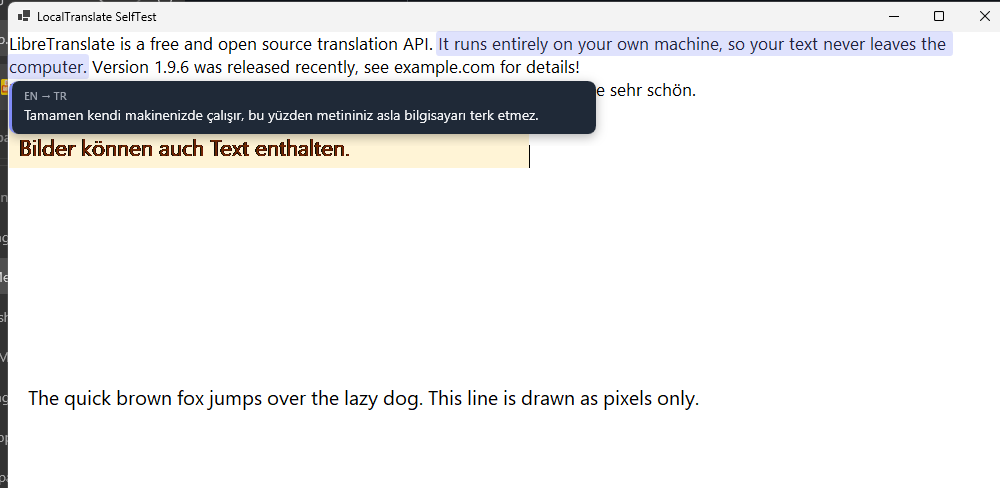
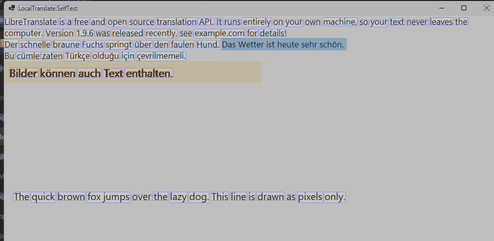
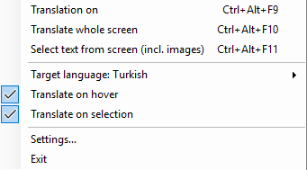
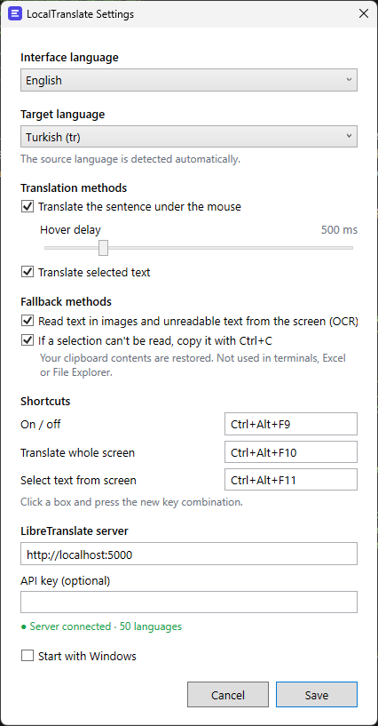
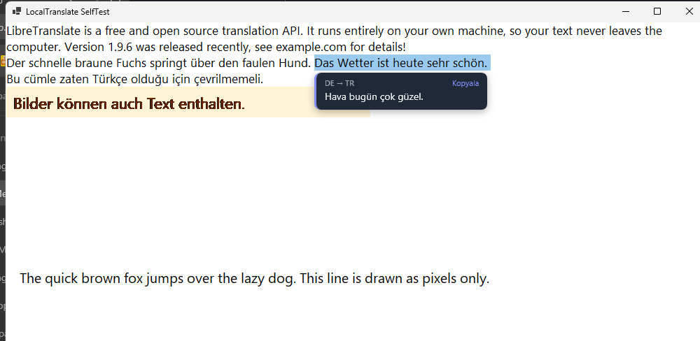
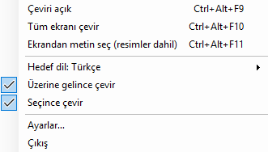
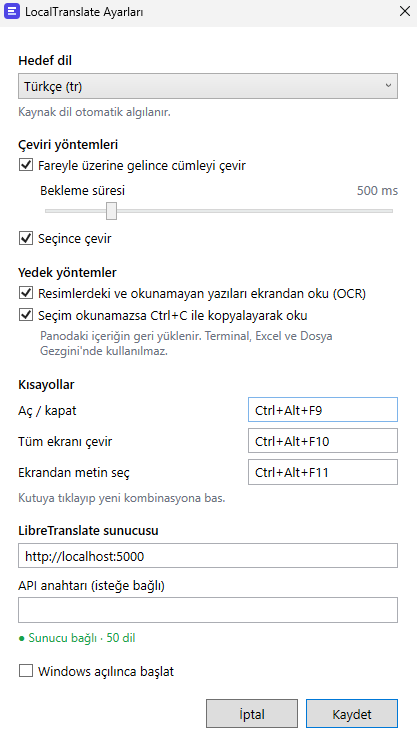

# LocalTranslate

[English](#english) · [Türkçe](#türkçe)

[Architecture](docs/ARCHITECTURE.md) · [Troubleshooting](docs/TROUBLESHOOTING.md) · [Contributing](CONTRIBUTING.md) · [Changelog](CHANGELOG.md)

---

## English

A Windows desktop app. Hover over a sentence or select text with the mouse, and it is translated with a local [LibreTranslate](https://github.com/LibreTranslate/LibreTranslate) server and shown right below it. The source language is detected automatically. It works in browsers, Word, Notepad, PDF readers, Outlook and most other apps.

### Screenshots

**Translate on hover, no selecting needed** — rest the mouse over a sentence. It is recognized automatically, highlighted, and its translation appears right below:



**Translate a selection** — select text and the translation appears below it, with a Copy button:


**Select text from the screen** (`Ctrl+Alt+F11`) — for text you can't select, such as pictures. The screen freezes; drag over recognized words or click one:



**Tray menu** — right-click the tray icon:



**Settings** — the interface language, target language, methods, shortcuts and server:



### Running

```
dist\LocalTranslate.exe
```

A single file. No .NET installation required.

The app lives in the notification area next to the clock. It has no main window.

LibreTranslate must be running (`http://localhost:5000`). If the server does not respond when the app starts, the app tries `docker start libretranslate` itself. Docker Desktop must be open for that.

### Usage

| What | How |
| --- | --- |
| Translate on hover | Hold the mouse over a sentence for about 0.5 s. The sentence is highlighted and its translation appears right below. Moving away hides it. |
| Translate on selection | Select text by dragging, double-clicking or Shift+click. The translation appears below and stays until the next click. Use **Copy** to copy it. |
| Translate the whole screen | `Ctrl+Alt+F10`. All visible text, including text inside images, is covered in place with its translation. Translations update immediately when the screen changes (scrolling, new page). Press again to turn off. |
| Select text from screen | `Ctrl+Alt+F11`. The screen freezes and the recognized words are shown in boxes. Drag over them, or click a word to get its whole sentence. Useful for text that cannot be selected normally, such as images, videos or PDF pictures. `Esc` cancels. |
| On / off | `Ctrl+Alt+F9`, or left-click the tray icon. The icon turns gray when off. |
| Menu | Right-click the tray icon: target language, modes, Settings, Exit. |

Text already in the target language is left alone. In whole-screen mode, the language of each sentence is detected separately, so in a mixed-language paragraph only the sentences that need it are translated. Code and command lines are not translated.

The shortcuts use F-keys on purpose. On a Turkish Q keyboard (and other layouts with AltGr), `Ctrl+Alt+letter` is really AltGr+letter, which types characters such as ₺, € or @. Registering those as shortcuts would block typing them. You can change the shortcuts in Settings.

### How it reads text

1. **UI Automation:** Windows' accessibility interface. Chrome/Edge, Word, Notepad, Outlook and most apps expose their text this way. Fast (~10 ms) and exact.
2. **OCR:** If the cursor is over an image, or the app does not expose its text (games, remote desktops), the area around the cursor is captured and read with Windows' built-in OCR engine (~100 ms). Whole-screen mode and screen text selection also use OCR.
3. **Ctrl+C (fallback for selections only):** If a selection cannot be read, the app sends Ctrl+C, reads the clipboard, and then restores what was there before. Not used in terminals, Excel or File Explorer.

The fallbacks can be turned off in Settings.

### Settings

The interface is available in English and Turkish. By default it follows the Windows display language (Turkish on a Turkish Windows, English otherwise). You can choose a language yourself under **Interface language** in Settings.

Settings are stored in `%APPDATA%\LocalTranslate\settings.json`. Errors are written to `error.log` in the same folder. The "Start with Windows" option is in the Settings window.

### Building

Requires the .NET 10 SDK.

```
dotnet publish LocalTranslate.csproj -c Release -r win-x64 --self-contained true -p:PublishSingleFile=true -p:IncludeNativeLibrariesForSelfExtract=true -p:EnableCompressionInSingleFile=true -p:DebugType=none -o dist
```

Tests: `tools\SelfTest` opens a test window. It checks reading text with UI Automation and OCR, the LibreTranslate connection, and sentence splitting.
`SelfTest.exe e2e <path to LocalTranslate.exe>` runs the real app, moves the mouse itself and saves screenshots.
`SelfTest.exe screen <exe>` tests only whole-screen mode. It saves the screenshot with the translation layer on top as a PNG, and each block's sentence-by-sentence translation as a .txt file.
The translation layer is deliberately excluded from screen capture, otherwise OCR would read its own translations.

### Documentation

- [Architecture](docs/ARCHITECTURE.md): components, threads, and the reasoning behind them
- [Troubleshooting](docs/TROUBLESHOOTING.md): server, hotkeys, OCR, and where logs are
- [Contributing](CONTRIBUTING.md): build, test, guidelines
- [Changelog](CHANGELOG.md)

---

## Türkçe

Windows masaüstü uygulaması. Fareyi bir cümlenin üzerinde tutun ya da metin seçin; yerel bir [LibreTranslate](https://github.com/LibreTranslate/LibreTranslate) sunucusuyla çevrilip hemen altında gösterilir. Kaynak dil otomatik algılanır. Tarayıcı, Word, Not Defteri, PDF okuyucu, Outlook ve diğer çoğu uygulamada çalışır.

### Ekran görüntüleri

**Seçmeden, fareyi getirince çevirme** — fareyi bir cümlenin üzerinde tutun. Cümle kendiliğinden tanınır, vurgulanır ve çevirisi hemen altında çıkar:


**Seçimi çevirme** — metni seçin, çeviri altında çıkar; Kopyala düğmesiyle kopyalanır:



**Ekrandan metin seçme** (`Ctrl+Alt+F11`) — resim gibi seçilemeyen yazılar için. Ekran donar; tanınan kelimelerin üzerinden sürükleyin ya da birine tıklayın:


**Tepsi menüsü** — simgeye sağ tıklayınca:



**Ayarlar** — arayüz dili, hedef dil, yöntemler, kısayollar ve sunucu:



### Çalıştırma

```
dist\LocalTranslate.exe
```

Tek dosya. .NET kurulumu gerektirmez.

Simgesi saatin yanındaki bildirim alanına gelir. Ana penceresi yoktur.

LibreTranslate'in açık olması gerekir (`http://localhost:5000`). Uygulama açılırken sunucu cevap vermezse `docker start libretranslate` komutunu kendisi dener. Bunun için Docker Desktop açık olmalı.

### Kullanım

| Ne | Nasıl |
| --- | --- |
| Üzerine gelince çevir | Fareyi bir cümlenin üzerinde ~0,5 sn tut. Cümle vurgulanır, çevirisi hemen altında çıkar. Fareyi cümleden çekince kaybolur. |
| Seçince çevir | Metni sürükleyerek seç, çift tıkla ya da Shift+tıkla. Çeviri altında açılır, bir sonraki tıklamaya kadar kalır. **Kopyala** ile kopyalanır. |
| Tüm ekranı çevir | `Ctrl+Alt+F10`. Ekrandaki bütün yazılar (resimlerdekiler dahil) yerinde, hedef dile çevrilmiş haliyle örtülür. Ekran değişince (kaydırma, yeni sayfa) çeviri anında güncellenir. Tekrar basınca kapanır. |
| Ekrandan metin seç | `Ctrl+Alt+F11`. Ekran donar, bulunan kelimeler kutu içinde gösterilir. Sürükleyerek seç ya da bir kelimeye tıklayıp cümlesini al. Resim, video, PDF görüntüsü gibi seçilemeyen yazılar için. `Esc` iptal eder. |
| Aç / kapat | `Ctrl+Alt+F9` ya da tepsi simgesine sol tık. Kapalıyken simge gri olur. |
| Menü | Tepsi simgesine sağ tık: hedef dil, modlar, Ayarlar, Çıkış. |

Metin zaten hedef dildeyse dokunulmaz. Tüm ekran modunda her cümlenin dili ayrı algılanır; böylece karışık dilli bir paragrafta sadece gereken cümleler çevrilir. Kod ve komut satırları çevrilmez.

Kısayollar bilerek F tuşlarıyla. Türkçe Q klavyede `Ctrl+Alt+harf` aslında AltGr+harf demek (₺, € veya @ gibi karakterleri yazmak için kullanılır); bunlar kısayol yapılırsa o karakterler yazılamaz. Kısayollar Ayarlar'dan değiştirilebilir.

### Metni nasıl okuyor?

1. **UI Automation:** Windows'un erişilebilirlik arayüzü. Chrome/Edge, Word, Not Defteri, Outlook ve çoğu uygulama metnini bu yolla verir. Hızlı (~10 ms) ve kesin.
2. **OCR:** İmleç bir resmin üzerindeyse ya da uygulama metnini vermiyorsa (oyunlar, uzak masaüstü) imlecin çevresinin görüntüsü Windows'un yerleşik OCR'ı ile okunur (~100 ms). Tüm ekran modu ve ekrandan seçme de OCR kullanır.
3. **Ctrl+C (yalnızca seçim için yedek):** Seçim okunamazsa uygulama Ctrl+C gönderir, metni panodan alır ve panodaki eski içeriği geri koyar. Terminal, Excel ve Dosya Gezgini'nde kullanılmaz.

Yedek yöntemler Ayarlar'dan kapatılabilir.

### Ayarlar

Arayüz İngilizce ve Türkçe olarak kullanılabilir. Varsayılan olarak Windows'un görüntüleme dilini izler (Türkçe Windows'ta Türkçe, diğerlerinde İngilizce). Ayarlar'daki **Arayüz dili** bölümünden kendiniz de seçebilirsiniz.

Ayarlar `%APPDATA%\LocalTranslate\settings.json` dosyasında tutulur. Hatalar aynı klasördeki `error.log` dosyasına yazılır. "Windows açılınca başlat" seçeneği Ayarlar penceresinde.

### Derleme

.NET 10 SDK gerekir.

```
dotnet publish LocalTranslate.csproj -c Release -r win-x64 --self-contained true -p:PublishSingleFile=true -p:IncludeNativeLibrariesForSelfExtract=true -p:EnableCompressionInSingleFile=true -p:DebugType=none -o dist
```

Testler: `tools\SelfTest` bir test penceresi açar. Bu pencerede UI Automation ve OCR ile okumayı, LibreTranslate bağlantısını ve cümle bölmeyi dener.
`SelfTest.exe e2e <LocalTranslate.exe yolu>` gerçek uygulamayı çalıştırır, fareyi kendisi hareket ettirir ve ekran görüntüleri kaydeder.
`SelfTest.exe screen <exe>` sadece tüm ekran modunu dener. Ekran görüntüsü ile çeviri katmanını üst üste koyup PNG olarak, her bloğun cümle cümle çevirisini de .txt olarak kaydeder.
Çeviri katmanı ekran görüntülerine bilerek girmez; aksi halde OCR kendi çevirisini tekrar okurdu.

### Dokümantasyon

- [Mimari](docs/ARCHITECTURE.md): bileşenler, iş parçacıkları ve nedenleri
- [Sorun giderme](docs/TROUBLESHOOTING.md): sunucu, kısayollar, OCR ve günlük dosyaları
- [Katkı](CONTRIBUTING.md): derleme, test ve kurallar
- [Değişiklikler](CHANGELOG.md)
